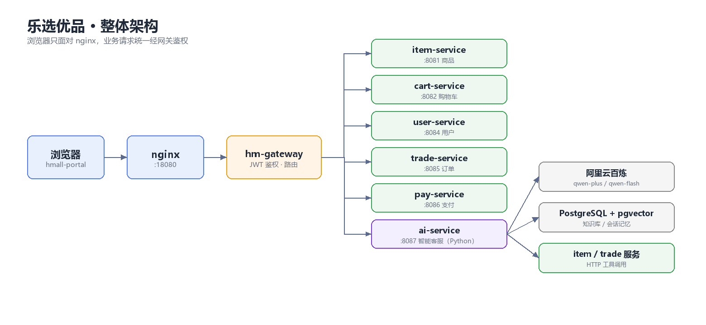
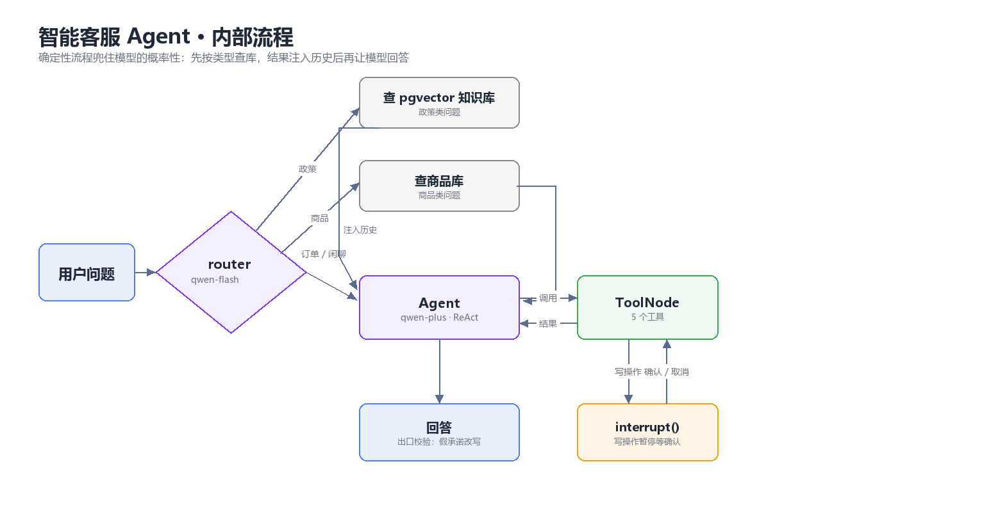

# 乐选优品 · Lexuan Youpin

一个 **Spring Cloud 微服务电商** + **LangGraph 智能客服 Agent** 的完整项目。

> 产品名：乐选优品　｜　客服人格：小乐　｜　仓库：`lexuan-mall`

---

## 这是什么

乐选优品是一个电商系统，由两套服务组成：

- **Java 侧**：Spring Cloud 微服务（商品 / 用户 / 购物车 / 交易 / 支付 / 网关），Nacos 注册与配置、RabbitMQ 异步消息、JWT 鉴权
- **Python 侧**：`ai-service`，基于 LangGraph 的智能客服 Agent，支持商品检索、订单查询、售后政策问答（RAG）与转人工

两套服务通过网关统一暴露，前端只面对一个域名。

---

## 架构





**纯文本版**（贴简历 / PPT 用，Word 里用等宽字体不会错位）：

```
浏览器 ──► nginx :18080 ──► gateway :8080 ──JWT──► item(:8081) cart(:8082) user(:8084)
                                        │            trade(:8085) pay(:8086)
                                        └──► ai-service :8087（Python）
                                                  │
                  ┌───────────────────────────────┼──────────────────────┐
                  ▼                               ▼                      ▼
          router（qwen-flash）           LangGraph Agent        pgvector / Postgres
          政策·订单·商品·闲聊            qwen-plus + 5 个工具    知识库 / 会话记忆
```

> 关键设计：网关只做鉴权和路由，业务身份通过 `user-info` 头往下传；
> ai-service 是独立的 Python 服务，与 Java 服务之间只用 HTTP 交互，不共享数据库。

---

## 模块

| 模块 | 端口 | 说明 |
|---|---|---|
| `hm-gateway` | 8080 | 网关，鉴权 + 路由 |
| `item-service` | 8081 | 商品 |
| `cart-service` | 8082 | 购物车 |
| `user-service` | 8084 | 用户与地址 |
| `trade-service` | 8085 | 订单 |
| `pay-service` | 8086 | 支付 |
| `ai-service` | 8087 | **智能客服 Agent（Python）** |
| `hm-common` / `hm-api` | — | 公共模块 / Feign 客户端 |
| `hm-service` | 8080 | 单体版（历史模块，与网关二选一） |

---

## 快速开始

### 1. 基础设施（端口）

| 组件 | 端口 | 用途 |
|---|---|---|
| Nacos | 8848 | 注册中心 + 配置中心 |
| MySQL | 3306 | 业务库（`hmall` / `hm-trade` 等） |
| PostgreSQL + pgvector | 5433 | 客服知识库 + 会话记忆 |
| RabbitMQ | 5672 | 异步消息（vhost `/itheima`） |

> 各服务通过 Nacos 发现彼此，地址配置在各自的 `application.yaml` 里，请按自己的环境修改。

### 2. 启动 Java 侧

```bash
mvn clean install -DskipTests
# 依次启动 item / user / cart / trade / pay / gateway
```

或双击根目录 `start-all.cmd`。

### 3. 启动 AI 侧

```bash
cd ai-service
python -m venv .venv && .venv\Scripts\activate
pip install -r requirements.txt
copy .env.example .env      # 填入百炼 API Key 和 PG 连接串
.\.venv\Scripts\python.exe run.py
```

### 4. 前端

商城前端是静态页面，由 nginx 托管，访问 **http://localhost:18080**。
客服组件代码见 `hmall-nginx/html/hmall-portal/js/chatbot.js`（其余前端资源为课程素材，未入库）。

---

## 技术栈

**Java**：Spring Boot 2.7 · Spring Cloud 2021 · Nacos · Gateway · OpenFeign · MyBatis-Plus · MySQL · RabbitMQ
**Python**：FastAPI · LangGraph · LangChain · 阿里云百炼（qwen-plus / text-embedding-v3）· PostgreSQL + pgvector
**前端**：Vue2（CDN）+ nginx

---

## 文档

- [ai-service 技术方案](ai-service/docs/01-设计文档.md)
- [ai-service 模块说明](ai-service/README.md)

---

## 能力清单

**交易链路**

- 下单扣减库存 → 支付回调经 RabbitMQ 异步更新订单状态
- 延迟消息 + 发布确认失败重试，处理超时未支付订单
- 网关统一 JWT 鉴权，用户身份由网关注入请求头，业务侧不接收前端传入的 userId

**智能客服**

- 工具调用：商品检索 / 我的订单 / 订单详情 / 售后政策 RAG / 创建工单
- 多轮记忆：Postgres checkpointer，会话与用户绑定，服务重启不丢历史
- 写操作人工确认：`interrupt()` 暂停 → 前端弹卡片 → 用户确认后才落库
- 安全边界：会话归属校验、按用户滑动窗口限流、工具参数不含 userId
- 确定性前置检索：政策类、商品类问题在进模型前强制查库，避免模型凭记忆编答案
- 可观测性：请求级 trace、工具调用统计、单轮成本统计

---

## 效果与指标（实测，2026-11-10）

| 指标 | 结果 | 怎么测的 |
|---|---|---|
| 评测集工具选择准确率 | **99%**（89/90，3 轮均值） | `eval/run_eval.py`，售前 / 售中 / 售后各 10 条 |
| 关键信息命中率 | **100%**（5/5） | 同上：回答里必须出现指定关键词（状态、金额等） |
| 知识库召回率 | **100%**（20/20） | `eval/harness.py`，top-3 命中判定 |
| 工具调用成功率 | **94%**（158/169） | `scripts/tool_stats.py`，汇总真实调用日志 |
| 响应延迟 | 平均 **2.2s**，P95 **3.7s** | 30 条评测集逐条计时 |
| 单轮成本 | **¥0.0026**（输入 3024 / 输出 67 token） | `scripts/cost_report.py`，日活 1000 次 ≈ ¥2.6/天 |

> 口径说明：准确率取 3 轮评测均值（100% / 97% / 100%），单轮有波动，因此不写 100%；
> 成本按 qwen-plus 公开价估算（输入 0.8 元/百万 token、输出 2 元/百万 token），实际以控制台账单为准。

### 怎么复现

```powershell
cd ai-service
.\.venv\Scripts\python.exe eval\run_eval.py            # 端到端评测 → eval/report.md
.\.venv\Scripts\python.exe eval\harness.py             # 检索召回率
.\.venv\Scripts\python.exe scripts\tool_stats.py       # 工具调用统计
.\.venv\Scripts\python.exe scripts\cost_report.py      # 单轮成本
.\.venv\Scripts\python.exe scripts\trace_show.py <id>  # 回放一次请求的链路
```

### 可观测性

每次对话生成一个 `trace_id`，贯穿「前置检索 → 模型调用 → 工具执行 → 落库」：

```
+    0ms   api.chat.start
+  600ms   prefetch.knowledge     hit=3  top=退货运费规则
+ 2099ms   graph.run              ms=2079  tool_calls=['search_knowledge']
+ 2099ms   api.chat.end           ms=2098  status=done
```

- `GET /ai/traces/{trace_id}` 回放整条链路；`logs/traces.jsonl` 本地留存
- 需要更细的分析时，`.env` 里打开 `LANGSMITH_TRACING=true` 即可接入 LangSmith（业务代码零改动）

### 已知问题

- **写操作类用例有波动**：单轮可以跑满 100%，多轮平均 93%，模型偶尔跳过 create_ticket。
  目前靠出口校验兜住（不会出现“假承诺”），根治要靠 constrained decoding 或更细的意图分类。
- **意图分类会占一次额外调用**：用 qwen-flash 先分 政策/订单/商品/闲聊（约 200ms、¥0.0001），
  分类错了会走错链路。小模型离线用例 21/21，但真实说法更杂，仍是主要风险点。
- **限流存在进程内存**：只对单实例有效，多副本部署需要换成 Redis（ZSET 滑动窗口）。
- **知识库只有 15 篇**：20 条召回用例上的 100% 不代表全量覆盖，长尾政策问题仍会漏。
